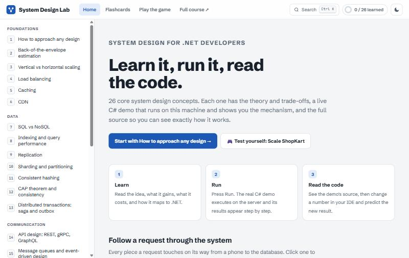
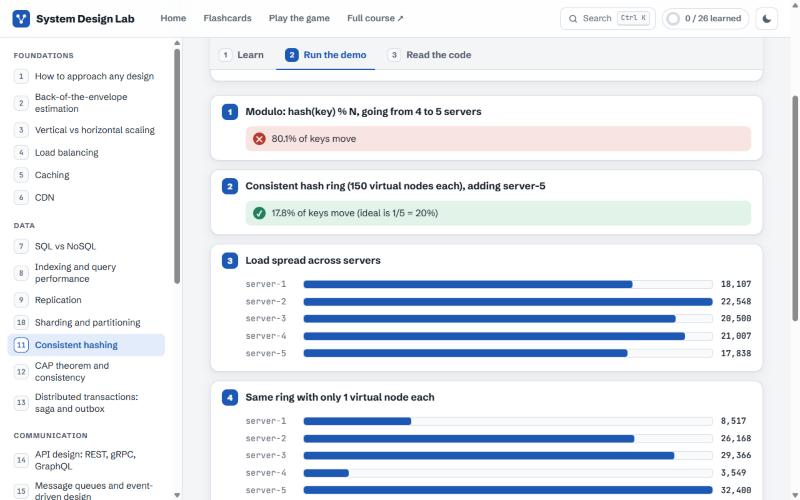
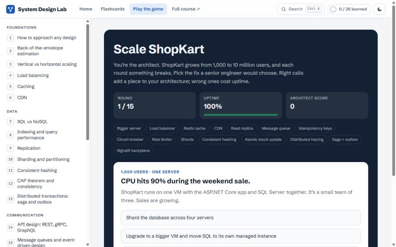

# System Design for .NET Developers

[](https://github.com/khujrat17/system-design-dotnet/actions/workflows/ci.yml)


[](LICENSE)

**Learn it, watch it, play it, run it, read the code.** 26 core system design concepts (caching, sharding, consistent hashing, rate limiting, sagas, circuit breakers and more), each with:

| 📖 Learn | ▶ Watch | 🎮 Play | ⚙️ Run | 🧑‍💻 Code |
|---|---|---|---|---|
| Theory, trade-offs, .NET mapping, interview angle | A narrated **animation** of the mechanism | A **mini-game** where you use it, for up to 3 ★ | A **live C# demo** on the server | The full, plain C# source |

Everything is free and open source, and it all runs on your machine with one command.



## Why this repo

Most system design material stops at boxes and arrows. Here you **watch** every concept move, **play** with it until it clicks, and then see it as **working code** in plain C#, with no libraries hiding the mechanism.

- Watch a cache stampede hit the database, then see single-flight fix it.
- Tune a token bucket until abusers get throttled and real users don't.
- Add a node to a hash ring and see only 1/N of the keys move.
- Trip a circuit breaker, and roll back a saga.

Learning is tracked in your browser: earn XP and stars, collect 10 badges, and level up from **Intern** to **Principal architect**.

| | |
|---|---|
|  |  |
| **Run** each demo and see its output as steps, charts and lessons. | **Play** Scale ShopKart: grow an app from 1,000 to 10 million users. |

## Quick start

You need the [.NET 10 SDK](https://dotnet.microsoft.com/download).

```bash
git clone https://github.com/khujrat17/system-design-dotnet.git
cd system-design-dotnet
dotnet run --project src/SystemDesign.Web
```

Then open **http://localhost:5090**. In Visual Studio, set `SystemDesign.Web` as the startup project and press F5.

**With Docker instead** (no .NET SDK needed):

```bash
docker build -t system-design-lab .
docker run --rm -p 8080:8080 system-design-lab      # http://localhost:8080
```

## What's inside the lab

- **Learn tab:** the idea, what it gains and what it costs, how it maps to .NET, an interview angle and a "check yourself" question.
- **Watch tab:** a step-by-step animated lesson. Each step plays a beat and stops; a side panel explains it (problem, technique, key idea, what changed), live metric cards update, and a "You'll learn" checklist ticks off. Use Back / Next or `←` `→`, jump to any step, auto-play, pause, and change speed.
- **Play tab:** a 30–90 second mini-game where you apply the idea. Earn up to 3 stars; every ending explains why.
- **Run tab:** runs the real demo on the server and draws its output: numbered steps, ✓/✕ outcomes, bar charts, and the lesson.
- **Code tab:** the demo's source with line numbers. Change a number in your IDE, predict the result, then run it again.
- **Arcade:** all 26 mini-games in one place, with your level, XP, stars and badges.
- **Flashcards:** spaced-repetition review of all 26 concepts. Missed cards come back first.
- **Scale ShopKart:** 15 production incidents, each with one best fix. Wrong calls cost uptime, and the game links you to what to revise.
- **Search** (`Ctrl K` or `/`), keyboard shortcuts (`←` `→`, `1`–`5`, `P`, `R`, `M`, `?`), progress tracking, and dark mode. Works on phones.

## The projects

| Project | What it is |
|---|---|
| `src/SystemDesign.Web` | **The System Design Lab** (start here): the browser UI described above. Animations and games are in `wwwroot/viz/`. |
| `src/SystemDesign.Concepts` | The **26 demos**, also runnable as a console app. Plain C#, no NuGet packages. |
| `src/ShopKart.Api` | A minimal ASP.NET Core API using the **framework's built-in** versions: health checks, cache-aside, output caching, rate limiting, idempotency keys, atomic stock updates, a background queue worker, cursor pagination, request timeouts and correlation IDs. |
| `src/ShopKart.Game` | Scale ShopKart as a console game. |
| `docs/system-design-course.html` | The full course as one standalone page. The lab reads its theory and game rounds from here. |
| `tests/SystemDesign.Tests` | Checks that every demo runs and ends with a lesson, and that the web app, its API and its rate limit work. |

### Other ways to run

```bash
dotnet run --project src/SystemDesign.Concepts            # console menu
dotnet run --project src/SystemDesign.Concepts -- 11      # one demo
dotnet run --project src/SystemDesign.Concepts -- all     # all 26
dotnet run --project src/ShopKart.Game                    # console game
dotnet run --project src/ShopKart.Api                     # then use src/ShopKart.Api/ShopKart.Api.http
dotnet test                                               # the test suite
```

## Suggested order

1. Play **Scale ShopKart** first. Note every round you get wrong.
2. Go through the concepts in order. For each one: **Learn → Watch → Play → Run → Read the code**. Aim for 3 stars before moving on.
3. In the code, change a number (shard count, TTL, rate limit), predict the output, and run it again.
4. Review with **Flashcards** until all 26 are mastered.
5. Run `ShopKart.Api` and hit each endpoint in the `.http` file to see the production-grade versions.
6. Do the two case studies (25, 26) on paper before running them, then compare.

About 30–40 minutes per concept takes you from zero to interview-ready in roughly 15 hours.

## Concept map

| # | Concept | Demo file | Also in ShopKart.Api |
|---|---|---|---|
| 1 | How to approach any design | `D01_Approach.cs` | |
| 2 | Back-of-the-envelope estimation | `D02_Estimation.cs` | |
| 3 | Vertical vs horizontal scaling | `D03_Scaling.cs` | note on Data Protection keys |
| 4 | Load balancing + health checks | `D04_LoadBalancing.cs` | `/health/live`, `/health/ready` |
| 5 | Caching (LRU, TTL, cache-aside, stampede) | `D05_Caching.cs` | `/products/{id}`, `/catalog` |
| 6 | CDN and edge caching | `D06_Cdn.cs` | |
| 7 | SQL vs NoSQL modelling | `D07_SqlVsNoSql.cs` | |
| 8 | Indexing | `D08_Indexing.cs` | |
| 9 | Replication and lag | `D09_Replication.cs` | |
| 10 | Sharding and shard keys | `D10_Sharding.cs` | |
| 11 | Consistent hashing | `D11_ConsistentHashing.cs` | |
| 12 | CAP and consistency | `D12_Cap.cs` | atomic stock reservation |
| 13 | Saga and outbox | `D13_SagaOutbox.cs` | |
| 14 | API design, cursor pagination | `D14_ApiPagination.cs` | `GET /orders?after=` |
| 15 | Message queues | `D15_Queues.cs` | `OrderEventsWorker` |
| 16 | Real-time push and backplanes | `D16_Realtime.cs` | |
| 17 | API gateway | `D17_Gateway.cs` | |
| 18 | Monolith vs microservices | `D18_Microservices.cs` | |
| 19 | Rate limiting algorithms | `D19_RateLimiting.cs` | `/search` |
| 20 | Timeouts, retries, circuit breakers | `D20_Resilience.cs` | `/slow-report` |
| 21 | Idempotency keys | `D21_Idempotency.cs` | `POST /orders` |
| 22 | Observability: traces, percentiles | `D22_Observability.cs` | correlation ID middleware |
| 23 | Auth: signed tokens, revocation | `D23_Security.cs` | |
| 24 | Search (inverted index), blob storage | `D24_StorageSearch.cs` | |
| 25 | Case study: URL shortener | `D25_UrlShortener.cs` | |
| 26 | Case study: news feed | `D26_NewsFeed.cs` | |

## Hosting the lab publicly

The lab is safe to put on the internet. It practises what it teaches:

- **Rate limiting** per visitor (`Lab:RunsPerMinutePerClient`, default 30) with `429` + `Retry-After`.
- **Concurrency limit** on demo runs across the server (`Lab:MaxConcurrentRuns`, default 4), plus one-at-a-time runs per demo.
- **Timeouts** on each run (`Lab:RunTimeoutSeconds`, default 30), and a `/health` endpoint for your host's health check.
- Set `Site:RepositoryUrl` (for example `https://github.com/khujrat17/system-design-dotnet`) to show "View on GitHub" links in the UI.

The Docker image runs on any container host (Azure Container Apps, App Service, Render, Fly.io and others). Settings can be passed as environment variables, such as `Site__RepositoryUrl`.

## Going to production

The demos are deliberately hand-rolled so you can see the mechanism. In real projects, use the mature libraries:
Redis (`StackExchange.Redis`, `HybridCache`), Polly / `Microsoft.Extensions.Http.Resilience`, MassTransit or NServiceBus,
SignalR with a Redis backplane or Azure SignalR Service, YARP, OpenTelemetry, EF Core, and a real identity provider.
The token code in demo 23 is for learning only: never use hand-rolled auth in production.

## Contributing

Fixes, clearer explanations, better games and new concepts are welcome. See [CONTRIBUTING.md](CONTRIBUTING.md) for how demos are structured, and [docs/ANIMATIONS.md](docs/ANIMATIONS.md) for the tiny toolkit behind every animation and mini-game (plain JavaScript, no build step).

If this helped you learn, **star the repo** so other .NET developers can find it.

## License

[MIT](LICENSE)
